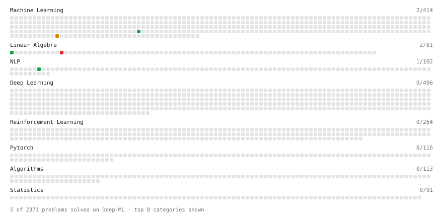

# Deep-ML

My machine learning practice from [Deep-ML](https://www.deep-ml.com). Every solution here was written by hand.

**7** solved · 6 problems · 0 labs · 1 math

[**Browse the interactive portfolio**](https://aditya00801.github.io/deep-ml/) to replay this filling in over time.

## Problems

| | Difficulty | Solved | |
| --- | --- | --- | --- |
| [Calculate Unigram Probability from Corpus](https://www.deep-ml.com/problems/129) | easy | 2026-11-23 | [solution](problems/0129-calculate-unigram-probability-from-corpus) |
| [Matrix-Vector Dot Product](https://www.deep-ml.com/problems/1) | easy | 2026-11-21 | [solution](problems/0001-matrix-vector-dot-product) |
| [Optimal Policy from a Loss Matrix](https://www.deep-ml.com/problems/1755) | easy | 2026-11-23 | [solution](problems/1755-optimal-policy-from-a-loss-matrix) |
| [Graph Auto-Encoder: GCN Encoder, Inner-Product Decoder and Reconstruction BCE](https://www.deep-ml.com/problems/1901) | medium | 2026-11-21 | [solution](problems/1901-graph-auto-encoder-gcn-encoder-inner-product-decoder-and-reconstruction-bce) |
| [Determinant of a 4x4 Matrix using Laplace's Expansion (hard)](https://www.deep-ml.com/problems/13) | hard | 2026-11-21 | [solution](problems/0013-determinant-of-a-4x4-matrix-using-laplace-s-expansion-hard) |
| [Manual Backprop Through Cross-Entropy Intermediates](https://www.deep-ml.com/problems/997) | hard | 2026-11-23 | [solution](problems/0997-manual-backprop-through-cross-entropy-intermediates) |

## Math

| | Difficulty | Solved | |
| --- | --- | --- | --- |
| [ML Workflow Basics](https://www.deep-ml.com/math-problems/30) | easy | 2026-11-21 | [solution](math/0030-ml-workflow-basics) |

---

_This file is regenerated by Deep-ML on every push._
